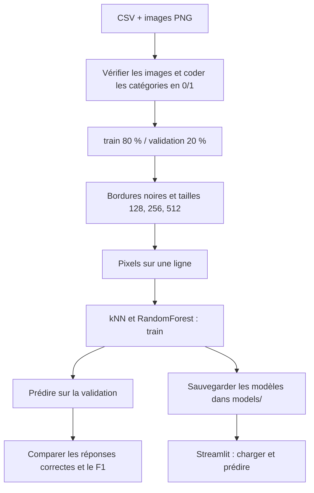

# CVRIE — Classification de radiographies

Reconnaître les parties du corps avec kNN et RandomForest.



Télécharger les données sur [Kaggle](https://www.kaggle.com/datasets/ibombonato/xray-body-images-in-png-unifesp-competion/data). Extraire les CSV et le dossier `images/` dans `archive-2/`, à la racine du projet. Les images sont exclues de Git car trop volumineuses.

Avec Python 3.12+, depuis le dossier du projet (macOS/Linux) :

```bash
python3 -m venv .venv
source .venv/bin/activate
python -m pip install -r requirements.txt
cd notebooks
python -m jupyterlab 01_analyse_images_fr.ipynb
```

Dans JupyterLab : **Run → Run All Cells**. Les six modèles sont enregistrés dans `models/`, exclu de Git.

Dashboard, depuis la racine du projet avec le même environnement :

```bash
python -m streamlit run app.py
```

Après le notebook, choisir une image de validation, sa taille et le modèle, puis **Prédire**. Streamlit charge le modèle enregistré sans refaire le train.
