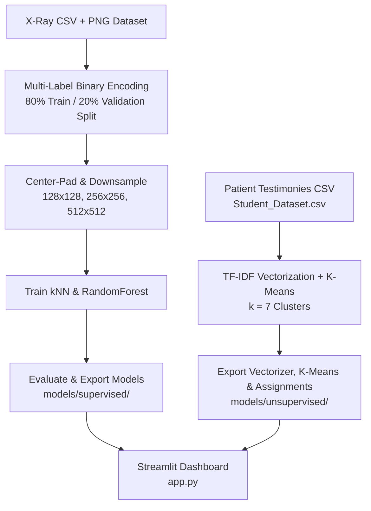

# CVRIE — Medical X-Ray Classification & Patient Testimony Clustering

CVRIE is a dual-pipeline **machine learning project** combining **supervised computer vision** on medical radiographs and **unsupervised natural language processing** on patient testimonies, unified under an interactive **Streamlit** dashboard.

---

## Key Features

- **Supervised Learning — Multi-Label X-Ray Classification (`Supervised_Learning/`):**
  - Processes body radiograph PNG images across **22 anatomical categories** (Abdomen, Ankle, Cervical Spine, Chest, Clavicles, Elbow, Feet, Finger, Forearm, Hand, Hip, Knee, Lower Leg, Lumbar Spine, Pelvis, Shoulder, Sinus, Skull, Thigh, Thoracic Spine, Wrist, Other).
  - Evaluates image downsampling resolutions (`128×128`, `256×256`, `512×512`) flattened into feature vectors with an 80% / 20% train-validation split.
  - Trains and benchmarks **k-Nearest Neighbors (`kNN`)** and **Random Forest (`RandomForest`)** classifiers, exporting trained models to `models/supervised/`.
- **Unsupervised Learning — Patient Testimony Clustering (`Unsupervised_Learning/`):**
  - Vectorizes free-text patient testimonies (`Student_Dataset.csv`) using **TF-IDF** and groups them into **7 semantic clusters** via **K-Means**.
  - Computes silhouette scores, extracts top cluster keywords and representative examples, and exports the trained pipeline (`text_model.joblib` and `patients.csv`) to `models/unsupervised/`.
- **Interactive Streamlit Dashboard (`app.py`):**
  - **Radiographs Mode:** Browse validation or test X-ray scans at `128×128`, `256×256`, or `512×512` resolution, select `kNN` or `RandomForest`, compare ground-truth labels against model predictions (on validation), and run inference on unseen test scans.
  - **Testimonies Mode:** Inspect patient testimonies by cluster ID and classify new free-text patient descriptions into their closest cluster in real time.

---

## Architecture & Pipeline



---

## Project Structure

```text
cvrie/
├── Supervised_Learning/
│   └── Image_Analysis.ipynb            # X-ray preprocessing, kNN & RandomForest training
├── Unsupervised_Learning/
│   ├── Clustering.py                   # K-Means clustering, silhouette score & keyword extraction
│   ├── Dataset.py                      # CSV dataset loader
│   ├── Preprocessing.py                # Text cleaning & TF-IDF vectorization
│   ├── Learning_model.py               # CLI training script exporting unsupervised artifacts
│   ├── Student_Dataset.csv             # Patient testimonies dataset
│   └── Unsupervised_Learning.ipynb     # Exploratory clustering & evaluation notebook
├── app.py                              # Interactive Streamlit dashboard
├── requirements.txt                    # Python dependencies
└── README.md
```

---

## Dataset Setup

1. Download the UNIFESP X-ray body images dataset from [Kaggle](https://www.kaggle.com/datasets/ibombonato/xray-body-images-in-png-unifesp-competion/data).
2. Place `train_df.csv` inside `archive-2/` and extract the PNG files into:
   - `archive-2/images/train/`
   - `archive-2/images/test/`
3. The patient testimonies dataset is already included at `Unsupervised_Learning/Student_Dataset.csv`.
   *(Note: `archive-2/` and `models/` are excluded from Git via `.gitignore` due to file size.)*

---

## Installation & Usage

### 1. Create the Virtual Environment

```bash
git clone https://github.com/AlexandrG1209/cvrie.git
cd cvrie
python3 -m venv .venv
source .venv/bin/activate
python -m pip install -r requirements.txt
```

### 2. Train & Export the Models

- **Supervised (X-Rays):** Launch JupyterLab and execute `Supervised_Learning/Image_Analysis.ipynb` to train and save the models into `models/supervised/`:

```bash
python -m jupyterlab
```

- **Unsupervised (Patient Testimonies):** Run the training script to generate `models/unsupervised/text_model.joblib` and `models/unsupervised/patients.csv`:

```bash
python Unsupervised_Learning/Learning_model.py
```

### 3. Launch the Streamlit Dashboard

```bash
python -m streamlit run app.py
```

---

## Tech Stack

- **Language:** Python 3
- **Machine Learning:** `scikit-learn`, `joblib`
- **Data & Image Processing:** `numpy`, `pandas`, `matplotlib`
- **Dashboard & Notebooks:** `streamlit`, `jupyterlab`

---

## Contributors

- **Alexandr Gorlachev** — [@AlexandrG1209](https://github.com/AlexandrG1209)
- **Benoit Leroy** — [@NoctifishE](https://github.com/NoctifishE)
