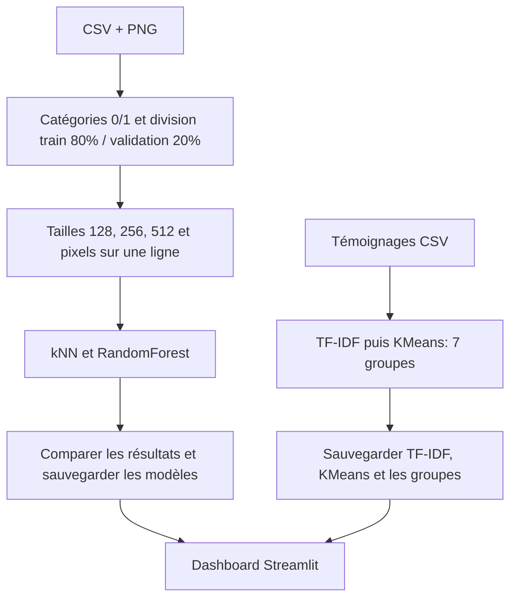

# CVRIE Images et témoignages

Classer les radiographies avec kNN et RandomForest. Regrouper les témoignages avec TF-IDF et KMeans.



Télécharger les images sur [Kaggle](https://www.kaggle.com/datasets/ibombonato/xray-body-images-in-png-unifesp-competion/data). Placer `train_df.csv` dans `archive-2/` et les PNG dans `archive-2/images/train/` et `archive-2/images/test/`. Les textes sont dans `Unsupervised_Learning/Student_Dataset.csv`. Les images et les modèles sont exclus de Git car trop volumineux.

## Lancer

Depuis la racine du projet, sur macOS/Linux:

```bash
python3 -m venv .venv
source .venv/bin/activate
python -m pip install -r requirements.txt
python -m jupyterlab
```

Exécuter `Supervised_Learning/Image_Analysis.ipynb` pour sauvegarder les modèles dans `models/supervised/`. Pour les textes, le notebook `Unsupervised_Learning/Cluster.ipynb` présente l’analyse, le script ci-dessous sauvegarde le modèle.

Dans un autre terminal, avec le même environnement:

```bash
python Unsupervised_Learning/Unsupervised_Learning.py
python -m streamlit run app.py
```

Choisir **Radiographies** ou **Témoignages**. Le dashboard charge les fichiers enregistrés, sans refaire le train. TF-IDF, KMeans et les groupes sont sauvegardés dans `models/unsupervised/` par le script des textes.

Pour les images : **Validation** affiche les catégories réelles et la prédiction ; **Test** affiche seulement la prédiction.
